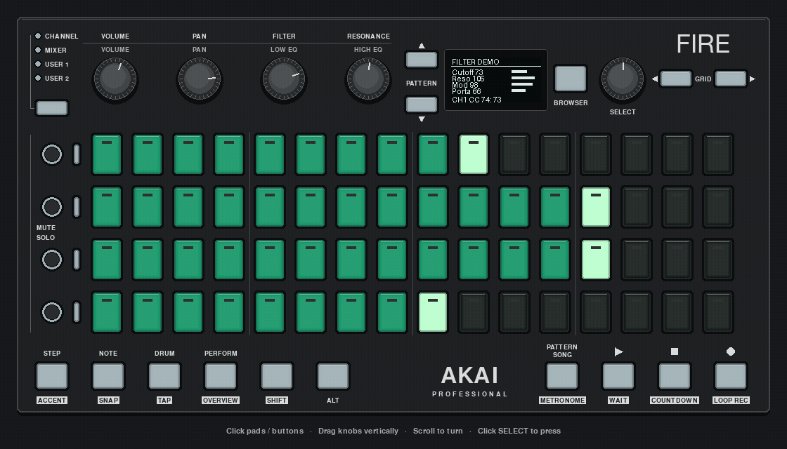

# AKAI Fire for Python

A **Python library and application framework** for controlling the AKAI Fire and building custom applications.

Handle pad, button and encoder input, control RGB LEDs, and draw on the 128×64 OLED over USB MIDI.

[](docs/images/mock-demo.png)

*JT-4000 editor in the pygame mock, showing pad faders, OLED graphs and note activity. [Still PNG](docs/images/mock-demo.png) · [Mock controls and hardware comparison](docs/MOCK_GUI.md)*

## Library, framework and testing tools

Use the device library inside an existing program, or build an application with the optional framework. All three packages ship together:

| Package | Use it to |
| --- | --- |
| `akai_fire` | Connect to the controller, handle input events, set pad/button/track LEDs, and draw on the OLED with `Canvas` |
| `akai_fire_framework` | Build apps with `AkaiFireApp`: lifecycle hooks, a display loop, input routing, cleanup, and optional mode/screen/grid/transport helpers |
| `akai_fire_testing` | Test your code without hardware using headless controller/MIDI mocks, simulated input and output assertions |

Use the pygame and terminal mocks for interactive development, and headless mocks for automated tests.

## Get started

Use Python 3.12 and [uv](https://docs.astral.sh/uv/).

```sh
git clone https://github.com/HelgeSverre/akai-fire-looper.git
cd akai-fire-looper
uv sync --all-extras
uv run python -m examples.apps.pad_counter
```

With a Fire connected, the example uses its MIDI ports. Otherwise it opens the clickable pygame mock. Close the window or press Ctrl+C to exit.

To open the mock on its own:

```sh
uv run python mock_gui_pygame.py
```

## Build your own application

Follow the [pixel editor tutorial](docs/BUILDING_AN_APP.md) to build a complete app with queued input, pad/OLED views, press-to-edit settings, JSON persistence and tests. For a smaller starting point:

Save this as `my_fire_app.py` in the repository root and run `uv run python my_fire_app.py`:

```python
from akai_fire_framework import AkaiFireApp


class PadLights(AkaiFireApp):
    def on_init(self):
        self.canvas.draw_text("Press a pad", 28, 20)
        self.canvas.draw_text("STOP to exit", 24, 38)

    def on_pad_press(self, pad, velocity):
        self.fire.set_pad_color(pad, 0, 100, 30)

    def on_button_press(self, button, event):
        if button == self.fire.BUTTON_STOP and event == "press":
            self.quit()


if __name__ == "__main__":
    with PadLights() as app:
        app.run()
```

The framework runs the display loop, processes mock input, and cleans up its handlers and connections on shutdown. Use `on_update(dt)` to update the display and `on_encoder_turn(...)` for knob input. See the [framework guide](docs/FRAMEWORK.md) for hooks, mixins, threading and resource ownership.

## Use the library in another project

Add the packages from this repository to an existing uv project:

```sh
uv add "akai-fire-looper @ git+https://github.com/HelgeSverre/akai-fire-looper.git"
```

The repository and distribution retain the original `akai-fire-looper` name. Import the Python APIs from `akai_fire`, `akai_fire_framework` and `akai_fire_testing`.

For direct hardware control:

```python
from akai_fire import AkaiFire

with AkaiFire() as fire:
    fire.set_multiple_pad_colors([(0, 127, 0, 0), (1, 0, 127, 0)])
    canvas = fire.get_canvas()
    canvas.draw_text("Hello Fire", 30, 24)
    fire.render_to_display()
    input("Press Enter to close the hardware connection...")
```

`AkaiFire()` requires hardware. Pads use indices 0–63 and RGB channels 0–127. OLED pixels use `0` for lit and `1` for unlit. The device context manager clears the display and closes MIDI; call `clear_all()` when you also want LEDs cleared.

The driver keeps static OLED images visible by refreshing the last submitted frame after two idle seconds. Use `AkaiFire(oled_keepalive=False)` to allow display sleep or manage refresh yourself. See [display behavior](docs/DEVICE.md#oled-display).

Interactive mocks and examples run from a repository checkout, where `get_akai_fire()` selects hardware or a mock. Use `akai_fire_testing.MockAkaiFire` for headless tests in any project. Apps also accept an explicit controller, such as `PadLights(fire)`; the caller owns and closes that connection.

## Common tasks

List MIDI ports without opening a controller connection:

```python
from akai_fire import AkaiFire

ports = AkaiFire.list_midi_ports()
print("Inputs:", ports["input"])
print("Outputs:", ports["output"])
```

Draw an OLED layout and save a preview without hardware:

```python
from akai_fire import Canvas

canvas = Canvas()
canvas.draw_menu("Choose a tool", ["Synth editor", "MIDI Scope", "Snake"], 2)
canvas.image.save("oled-preview.png")
```

The saved image uses black for lit pixels. Use `fire.render_to_display(canvas)` to send the same canvas to a connected Fire. Layouts fit labels to their available width; use `draw_text_fitted()` for bounded labels and `draw_text()` for custom drawing or scrolling.

Test the `PadLights` class above by injecting a headless controller:

```python
from akai_fire_testing import MockAkaiFire
from my_fire_app import PadLights

with MockAkaiFire() as fire, PadLights(fire) as app:
    fire.simulate_pad_press(17, velocity=100)
    fire.assert_pad_color(17, (0, 100, 30))
    app.run(duration=0)  # Exercise startup and shutdown without a GUI.
```

The [device guide](docs/DEVICE.md) covers callback signatures, batched pad updates, LED values and display primitives.

## Explore the examples

The [example catalog](examples/README.md) covers pad colors, OLED graphics, input events, LEDs, batching and mocks.

| Example app | What it demonstrates | Run from the checkout |
| --- | --- | --- |
| [Pixel editor](examples/apps/pixel_editor/README.md) | The end-to-end tutorial: shared state, pad/OLED views, menus, saving and tests; defaults to pygame | `uv run python -m examples.apps.pixel_editor` |
| [Circuit](examples/apps/circuit/README.md) | A four-track MIDI sequencer with a separate musical clock, step editing and mode-based controls | `uv run python -m examples.apps.circuit` |
| [JT-4000 editor](examples/apps/synth_editor/README.md) | Parameter pages, pad faders, OLED visualizations, MIDI CC output and local snapshots | `uv run python -m examples.apps.synth_editor` |
| [Snake](examples/apps/snake/README.md) | One game model, synchronized pad/OLED views and button-driven movement | `uv run python -m examples.apps.snake` |
| [MIDI Scope](examples/apps/MIDI_SCOPE.md) | Input handling, encoder traces, live/frozen views and CSV export | `uv run python -m examples.apps.midi_scope` |

Circuit needs an explicitly selected instrument output for sound. The editor connects automatically only when exactly one JT-4000 output is present; otherwise it runs in preview mode. These apps send MIDI and do not generate computer audio. Their README files cover controls, prerequisites and limitations.

The clip looper and modal demo teach state management. Earlier sequencer experiments live in `examples/legacy`.

## Project status

Hardware callbacks can run on worker threads; applications must coordinate shared state with the display thread. The framework provides a UI frame loop; applications handle musical scheduling. Pad-release events and app-level reconnect notifications are current gaps. See the [framework guide](docs/FRAMEWORK.md) and [roadmap](docs/ROADMAP.md).

Automated tests exercise mocked MIDI ports and controller implementations. [Fire hardware checks](docs/HARDWARE_VERIFICATION.md) cover RGB output, OLED rendering/keepalive, encoders, several button/pad inputs, LED values and explicit reconnection on the same driver instance. Complete example-app and JT-4000 hardware validation is still pending.

## Documentation

- [Device API](docs/DEVICE.md): connections, callbacks, LED values, canvas and errors
- [Build an application tutorial](docs/BUILDING_AN_APP.md): a complete pixel editor, from first light to persistence and tests
- [Framework reference](docs/FRAMEWORK.md): lifecycle, mixins, testing and current gaps
- [Example catalog](examples/README.md): commands, prerequisites, status and naming
- [Interactive mock](docs/MOCK_GUI.md): hardware comparison, screenshots and mouse controls
- [Architecture](docs/ARCHITECTURE.md): package boundaries and resource ownership
- [Troubleshooting](docs/TROUBLESHOOTING.md): ports, mock windows, displays and silent instruments
- [Roadmap](docs/ROADMAP.md): library/framework priorities and example-app follow-ups

## Development

```sh
uv sync --all-extras
uv run python -m unittest discover
uv run ruff check .
uv run ruff format --check .
uv build
```

Discovery includes library, framework, mock and example-app tests. Ruff's full lint gate currently reports existing repository-wide style debt; see the [cleanup evidence](docs/code-cleanup.md) for the measured baseline and verification limits.

With [just](https://github.com/casey/just), use `just test`, `just example oled_wave`, or `just app synth_editor`.

## Credits

Built by [Helge Sverre](https://github.com/HelgeSverre).
