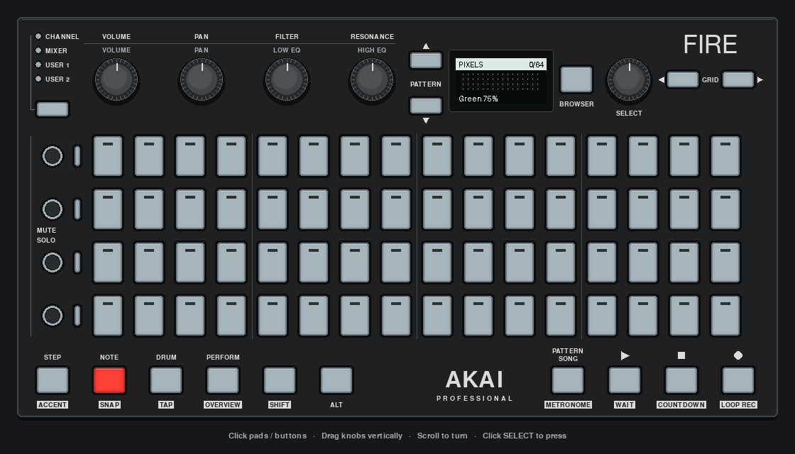
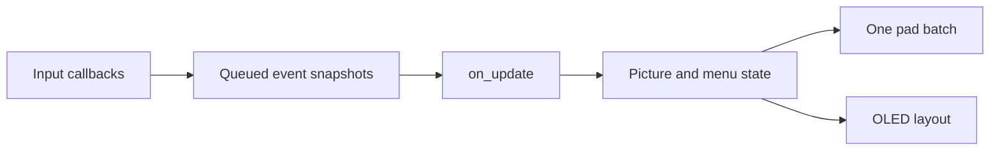
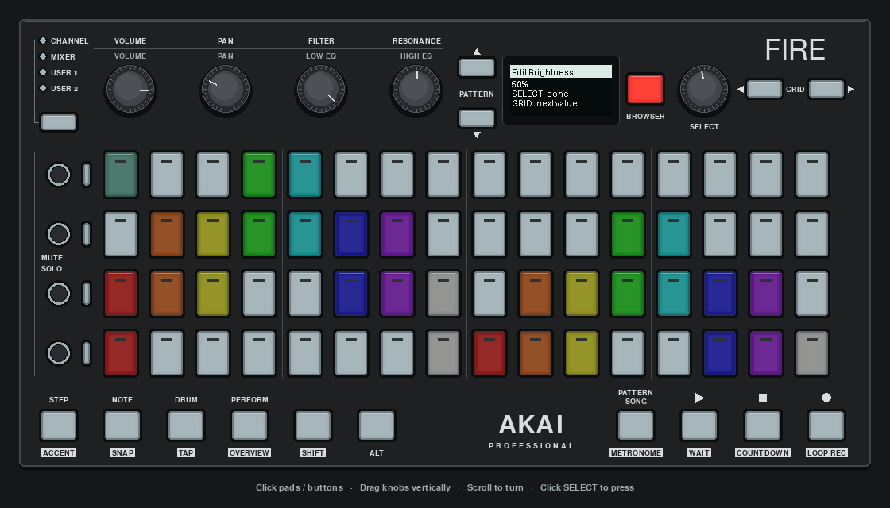

# Build an application: a pad and OLED pixel editor

Build a controller app that paints a 16×4 picture on the pads, previews it on the OLED, edits settings with SELECT, and saves it to a JSON file. The finished app uses `AkaiFireApp`, `ScreenMixin` and `EncoderMenu`.

You need basic Python: classes, functions, lists and context managers. No MIDI protocol knowledge or external instrument is required. Start in the pygame mock; the same app can use the Fire afterward.

[](images/pixel-editor.png)

*Actual app capture with scripted pad/encoder input: painting, menu editing and the shared OLED preview. [Still image](images/pixel-editor.png).*

The first checkpoint below is a complete small program. Later sections explain excerpts from the finished source; follow the linked files when assembling the full app. The [app README](../examples/apps/pixel_editor/README.md) is the short controls reference, and the [framework reference](FRAMEWORK.md) covers the underlying APIs.

## 1. Run the finished app once

From this repository's root, with Python 3.12 and uv installed:

```sh
uv sync --all-extras
uv run python -m examples.apps.pixel_editor
```

This particular app defaults to the pygame mock, even when a Fire is connected. Click pads, scroll over SELECT to turn it, and click SELECT to press it. Close the window to exit.

Try this short loop:

1. Click a few pads. They light green; filled squares appear at matching positions on the OLED.
2. Turn SELECT to choose a different brush color. Existing pixels keep their colors. Tap an existing pixel to recolor it; tap it again with the same brush to erase it.
3. Press BROWSER to open Settings. Turn SELECT to Brightness, press it, turn it to change the value, then press it again to finish.
4. Press BROWSER again to return to the picture. Press REC to save to `pixel-art.json` in the current directory.

For SHIFT gestures, use hardware or the automated tests below. In the mouse mock, erase by choosing a pixel's current brush color and tapping it again. Pad drawing works with ordinary clicks; there is no drag-to-paint behavior.

To use a connected Fire explicitly:

```sh
uv run python -m examples.apps.pixel_editor --hardware
```

Do not run a second app against the same controller at the same time. The app opens only the Fire connection; it does not select an instrument MIDI port.

## 2. Start with one input and two outputs

Run the smaller checkpoint:

```sh
uv run python -m examples.apps.pixel_editor.first_light
```

Each pad press toggles a green light. The OLED counts the lit pads, and STOP exits. Here is the complete [first_light.py](../examples/apps/pixel_editor/first_light.py); you can also save it as `first_light.py` in the repository root and run `uv run python first_light.py`.

<!-- source: examples/apps/pixel_editor/first_light.py:* -->
```python
"""Tutorial checkpoint: queued pad toggles, one LED batch and an OLED count."""

from queue import Empty, SimpleQueue

from akai_fire import get_akai_fire
from akai_fire_framework import AkaiFireApp


class FirstLight(AkaiFireApp):
    def on_init(self):
        self.presses: SimpleQueue[int] = SimpleQueue()
        self.lit: set[int] = set()

    def on_pad_press(self, pad, velocity):
        self.presses.put(pad)

    def on_button_press(self, button, event):
        if button == self.fire.BUTTON_STOP and event == "press":
            self.quit()

    def on_start(self):
        self.fire.clear_all()

    def on_update(self, dt):
        changed = False
        for _ in range(64):
            try:
                pad = self.presses.get_nowait()
            except Empty:
                break
            self.lit.symmetric_difference_update({pad})
            changed = True
        if changed:
            self.fire.set_multiple_pad_colors(
                [(pad, 0, 100 if pad in self.lit else 0, 0) for pad in range(64)]
            )
        self.canvas.draw_page(
            "First light", [f"Lit pads: {len(self.lit)}", "STOP to exit"]
        )


if __name__ == "__main__":
    with get_akai_fire(use_mock="pygame") as fire, FirstLight(fire) as app:
        app.run()
```

The runtime creates `self.canvas`, calls `on_init()` and registers the app's callbacks. `run()` calls `on_start()`, then `on_update(dt)` at up to 30 frames per second. After each update it sends the canvas to the display and pumps mock input on the foreground thread.

`on_pad_press()` only enqueues a pad index. `on_update()` owns the set of lit pads and the display. This matters because real hardware callbacks normally run on worker threads. Drawing from both a callback and the frame loop can produce partial or inconsistent screens.

`set_multiple_pad_colors()` sends the completed pad state in one batch when it changes. There is no need to clear and repaint 64 pads individually. OLED rendering is already handled by the base runtime; the app should not start another render loop.

**Checkpoint:** tap pads 1 and 64, then tap pad 1 again. Only the bottom-right pad should remain green, and the OLED count should be 1. Pad numbers in the API are zero-based: those are indices 0 and 63.

## 3. Give the picture a model

The first program stores a set of lit pads. A color editor needs more state: 64 RGB tuples, a brush color and a brightness percentage. These belong in [model.py](../examples/apps/pixel_editor/model.py), where they can be tested without a controller.

`Picture` is a dataclass. Its defaults are 64 black `(0, 0, 0)` pixels, green brush index 4, and brightness 75. Presets 1–8 select red, orange, yellow, green, cyan, blue, purple and white. `brush_color` resolves an optional custom RGB brush or the selected preset. Each painted pixel stores its own immutable RGB tuple, so changing the brush cannot recolor earlier pixels.

The model owns the toggle/recolor rule:

<!-- source: examples/apps/pixel_editor/model.py:Picture.paint -->
```python
def paint(self, pad: int, *, erase: bool = False) -> None:
    if not 0 <= pad < 64:
        raise ValueError("Pad must be between 0 and 63")
    self.pixels[pad] = (
        BLACK if erase or self.pixels[pad] == self.brush_color else self.brush_color
    )
```

A normal press copies the current RGB brush, or erases a pixel already painted with that color. An all-zero brush also erases. `erase=True` clears a pixel regardless of its current color. `Picture.clear()` empties the picture while keeping the brush and brightness.

The RGB conversion is also model-owned:

<!-- source: examples/apps/pixel_editor/model.py:Picture.pad_colors -->
```python
def pad_colors(self) -> list[tuple[int, int, int, int]]:
    return [
        (
            pad,
            *(round(channel * self.brightness / 100) for channel in color),
        )
        for pad, color in enumerate(self.pixels)
    ]
```

The palette uses the Fire's RGB channel range of 0–127. Brightness scales those values; it does not rewrite the stored RGB tuples. For example, green at 75% produces `(0, 95, 0)`. Raising brightness later restores the original color without losing information through repeated scaling.

The OLED is monochrome. It displays occupied pixels as filled squares and empty positions as small dots; the pads retain the full color picture. Neither view reads state back from the other.

**Checkpoint:** in the finished app, paint one green pixel, change the brush to blue and paint another. Change Brightness in Settings. Both pads should dim together, while their stored colors and the OLED's occupied positions stay unchanged.

## 4. Move input onto the frame thread

The finished [app.py](../examples/apps/pixel_editor/app.py) keeps input callbacks short. An immutable `Input` record carries the event kind, control ID, signed encoder delta and SHIFT state.

Capture modifiers when the callback runs:

<!-- source: examples/apps/pixel_editor/app.py:PixelEditorApp.on_pad_press -->
```python
def on_pad_press(self, pad, velocity):
    self.inputs.put(Input("pad", pad, shifted=self.fire.is_shift_pressed()))
```

Do not call `is_shift_pressed()` later in `on_update()` to interpret that press. SHIFT might already have been released. The driver provides a per-event modifier snapshot during the callback; the queued record preserves it until the frame consumes it.

Encoder direction becomes one signed delta:

<!-- source: examples/apps/pixel_editor/app.py:PixelEditorApp.on_encoder_turn -->
```python
def on_encoder_turn(self, encoder_id, direction, velocity):
    delta = velocity if direction == "clockwise" else -velocity
    self.inputs.put(Input("encoder", encoder_id, delta=delta))
```

The frame loop consumes a bounded number of records, applies them to the model/menu, and redraws when needed:

<!-- source: examples/apps/pixel_editor/app.py:PixelEditorApp.on_update -->
```python
def on_update(self, dt):
    if self.notice_left > 0:
        self.notice_left = max(0, self.notice_left - dt)
        if not self.notice_left:
            self.notice = ""
            self._dirty = True
    # Bound work per frame so an input burst cannot starve drawing.
    for _ in range(64):
        try:
            event = self.inputs.get_nowait()
        except Empty:
            break
        self._apply(event)
    if self._dirty:
        self._draw()
```



The limit of 64 records keeps drawing responsive during a burst. It is a per-frame work limit, not a bounded queue capacity. This app does not start additional workers or acquire model locks: callbacks write only to the queue, and the frame thread owns mutable application state.

A queue preserves insertion order; it cannot repair callbacks that reached it out of order. The hardware launcher therefore uses `max_workers=1`. If you inject your own hardware controller, give it the same setting. `async_handlers=False` runs callbacks on the MIDI polling thread, not on the display thread.

**Checkpoint:** hold SHIFT and tap a colored pad. It erases even if SHIFT is released before the next frame. The headless test later in this tutorial exercises that exact sequence without relying on mouse gestures.

## 5. Draw the two views

`PixelEditorApp` inherits from `AkaiFireApp` and `ScreenMixin`. The base owns the connection subscriptions and frame loop; the mixin supplies headers and menu layouts. The app decides what to render.

<!-- source: examples/apps/pixel_editor/app.py:PixelEditorApp._draw -->
```python
def _draw(self):
    # One pad batch per changed frame, rather than a clear/repaint burst.
    sent = self.fire.set_multiple_pad_colors(self.picture.pad_colors())
    self._dirty = not sent
    self.fire.set_button_led(
        self.fire.BUTTON_NOTE,
        self.fire.DUAL_LED_BRIGHT_PRIMARY if self.view == View.DRAW else 0,
    )
    self.fire.set_button_led(
        self.fire.BUTTON_BROWSER, 2 if self.view == View.SETTINGS else 0
    )
    self.canvas.clear()
    if self.view == View.SETTINGS:
        self._draw_settings()
    else:
        count = sum(color != BLACK for color in self.picture.pixels)
        self.draw_header("PIXELS", f"{count}/64" + ("*" if self.unsaved else ""))
        for pad, color in enumerate(self.picture.pixels):
            row, column = divmod(pad, 16)
            x, y = 8 + column * 7, 20 + row * 7
            if color != BLACK:
                self.canvas.fill_rect(x, y, 5, 5)
            else:
                self.canvas.fill_rect(x + 2, y + 2, 1, 1)
        footer = self.notice or (
            f"{self._rgb_label()} {self.picture.brightness}%"
            if self.picture.custom_color is not None
            else f"{self.picture.brush_name} {self.picture.brightness}%"
        )
        self.canvas.draw_text_fitted(footer, 4, 51)
```

The picture grid starts at `(8, 20)`, below the 16-pixel header. Cells are seven pixels apart and five pixels wide, leaving a two-pixel gap. Four rows end above the footer at `y=51`. The shared header helper reserves a four-pixel inset on each side and fits long text to its available width.

On `Canvas`, color **0 is lit** and color **1 is unlit**. Drawing primitives default to lit pixels. Do not reverse the image to make a PNG look familiar: the same canvas must remain correct on the Fire. The pygame mock presents it as light pixels on a dark display.

The count and `*` in the header describe the model; `*` means there are unsaved changes. The footer shows the preset name or custom RGB levels with brightness, or a short control/save/load message. Notifications expire using the elapsed `dt` passed by the runtime, so input is never blocked by a sleep.

`_dirty` prevents repeated pad batches for an unchanged picture. The base still sends the OLED after each `on_update()` call. If you use the device library without the app runtime, its default OLED keepalive preserves the last submitted image; it does not send unfinished canvas edits.

The status LEDs use the hardware-verified mappings: NOTE is a two-color button, so bright red is `DUAL_LED_BRIGHT_PRIMARY` (3). BROWSER is single-color, so bright red is 2. [The device reference](DEVICE.md#button-leds) explains why the legacy `LED_HIGH_*` aliases are not universal color selectors.

## 6. Add a press-to-edit settings menu

The app has two views, `DRAW` and `SETTINGS`. It creates the menu during `on_init()` so the state exists before the framework registers callbacks:

<!-- source: examples/apps/pixel_editor/app.py:PixelEditorApp.on_init -->
```python
def on_init(self):
    self.picture = Picture()
    self.view = View.DRAW
    self.inputs: SimpleQueue[Input] = SimpleQueue()
    self.unsaved = False
    self.notice = ""
    self.notice_left = 0.0
    self._dirty = True
    self.menu = EncoderMenu(
        [
            MenuItem("Color", adjust=self._adjust_color),
            MenuItem("Brightness", adjust=self._adjust_brightness),
            MenuItem("Save", activate=self._save),
            MenuItem("Load", activate=self._load),
            MenuItem("Back", activate=self._toggle_view),
            MenuItem("Quit", activate=self.quit),
        ]
    )
```

An `adjust` callback receives a signed delta. An `activate` callback performs an action when SELECT is pressed. Values stay in `Picture`; the menu owns only selection and edit state.

| Input in Settings | Result |
| --- | --- |
| Turn SELECT | Navigate, or adjust the current value while editing |
| Press SELECT on Color/Brightness | Enter editing; press again to finish |
| Press SELECT on Save/Load/Back/Quit | Run that action |
| GRID LEFT/RIGHT | Move between items, retaining an active edit when the destination is editable |
| BROWSER or NOTE | Leave Settings and finish editing |

The GRID behavior is an explicit choice in `_apply()`: `menu.move(delta, keep_editing=True)`. Reaching Save ends editing without executing it, because Save is an action. Use `menu.move(delta)` instead if navigation should always finish the current edit.

The four main knobs are direct shortcuts in **both** views:

| Knob | Effect |
| --- | --- |
| VOLUME | Red level of the brush, 0–127 |
| PAN | Green level of the brush, 0–127 |
| FILTER | Blue level of the brush, 0–127 |
| RESONANCE | Global brightness, 10–100% |

RGB changes use the signed encoder delta, clamped to the channel range. The app queues these events just like SELECT input. `Picture.adjust_channel()` creates a new custom brush tuple; already-painted pixels remain unchanged. The OLED reports the channel values. Brightness affects every pad without changing stored colors. These shortcuts do not navigate or end a SELECT edit session.

SELECT and GRID still choose presets in Draw, clearing the custom brush. When editing Color in Settings, SELECT does the same. A custom brush with all channels at zero paints black, which is erase. There is no separate custom-color slot to manage.

**Checkpoint:** paint a green pixel, turn VOLUME up and PAN down, then paint the adjacent pixel. Only the second pixel should use the mixed color. Turn RESONANCE: both should dim together. Turn SELECT to return to a named preset.

Color wraps around the palette. Brightness is clamped to 10–100% in five-point increments. The menu does not enforce either policy; the corresponding adjustment callbacks do. Navigation stops at the first/last item unless the menu is constructed with `wrap=True`.

The app draws a three-row scrolling menu with `draw_menu()`, then a separate value page with `canvas.draw_page()` while editing. Both layouts reserve room for the header. Do not assume that a 64-pixel-tall screen can fit an arbitrary title plus four large menu rows.



**Checkpoint:** enter Color editing, then press GRID RIGHT. The screen should change to Brightness editing. Press GRID RIGHT again: Save becomes selected, editing ends, and no file is written until SELECT is pressed.

## 7. Save and load without losing the current picture

Version 2 stores 64 RGB triples, the selected preset index, optional custom brush and brightness. Version-1 files from the original editor still load: their palette indices are converted to RGB tuples, preserving brightness and colors. New saves use version 2. Save is explicit; the app does not automatically load a file at startup or save when closing.

To choose a different path:

```sh
uv run python -m examples.apps.pixel_editor --file ./my-picture.json
```

REC and the Save menu action replace that file. Its parent directory must already exist. Load reads the same path and replaces the current picture, including unsaved edits. The `*` marker is a reminder to save before loading or quitting, not an automatic backup.

A failed save must leave the previous file intact:

<!-- source: examples/apps/pixel_editor/model.py:Picture.save -->
```python
def save(self, path: Path) -> None:
    payload = {
        "version": 2,
        "pixels": self.pixels,
        "brush": self.brush,
        "custom_color": self.custom_color,
        "brightness": self.brightness,
    }
    # A failed write must not truncate the previous picture. The temporary
    # file shares the destination directory so replacement stays atomic.
    temporary = None
    try:
        with tempfile.NamedTemporaryFile(
            mode="w", encoding="utf-8", dir=path.parent, delete=False
        ) as handle:
            temporary = Path(handle.name)
            json.dump(payload, handle, indent=2)
            handle.write("\n")
        temporary.replace(path)
    finally:
        if temporary is not None:
            temporary.unlink(missing_ok=True)
```

This writes a temporary file in the destination directory and replaces the target only after writing finishes. It protects against truncation on a failed write; it is not a disk-durability guarantee or a multi-process locking scheme.

`Picture.load()` validates the version, list length, every RGB triple (or legacy palette index), preset index, custom brush and brightness before returning a new model. It rejects booleans masquerading as integers and files with unsupported versions. The app installs that new model only after validation succeeds:

<!-- source: examples/apps/pixel_editor/app.py:PixelEditorApp._load -->
```python
def _load(self):
    try:
        picture = Picture.load(self.path)
    except (OSError, ValueError) as exc:
        self._notify("Load failed")
        print(f"Cannot load {self.path}: {exc}")
    else:
        # Replace the live model only after the entire file has validated.
        self.picture = picture
        self.unsaved = False
        self._notify("Loaded picture")
```

The OLED reports a short failure message; the terminal prints the path and error. A missing, malformed or invalid file leaves the current picture intact. Persistence is application policy, so these methods live with the example rather than in `AkaiFireApp`.

**Checkpoint:** save a picture, hold SHIFT and press STOP to clear it, then load it from Settings. The picture should return. A failed Load should show an error and leave the current pixels unchanged.

## 8. Own the controller and let the framework clean up

The launcher creates the controller and injects it into the app. This is the essential ownership structure:

```python
from akai_fire import get_akai_fire
from examples.apps.pixel_editor.app import PixelEditorApp

with get_akai_fire(use_mock="pygame") as fire, PixelEditorApp(fire) as app:
    app.run()
```

Context managers exit right-to-left. The app first removes its subscriptions and clears output. The outer controller context then closes the connection. An injected controller is borrowed; the app does not close it itself. If an app instead calls `AkaiFireApp()` without an injected controller, the base creates and owns that connection.

The real [launcher](../examples/apps/pixel_editor/__main__.py) adds the hardware and file options. It passes `max_workers=1` **only** to the hardware constructor. The factory forwards keyword arguments to the chosen backend; pygame does not accept this hardware option.

No custom `on_stop()` is needed here: the app has no workers, instrument connections or open file handles to release. For apps that acquire these resources, release them in `on_stop()`, and roll back resources locally if acquisition fails inside `on_init()`. `on_stop()` is not called to undo a failed constructor.

The first checkpoint uses STOP to exit. The full editor uses Quit in Settings, window close or Ctrl+C; SHIFT+STOP clears the picture. These are app choices, not framework-wide bindings.

## 9. Test input, state and outputs together

Run the maintained tests:

```sh
uv run python -m unittest tests.test_pixel_editor
```

They cover model edits, both views, menu transitions, modifier snapshots, failed saves, invalid loads, OLED text bounds and connection ownership. The real Canvas is used for geometry checks; headless mocks provide input and recorded output.

Here is a complete headless check you can save as `check_pixel_editor.py` in the repository root:

<!-- runnable: pixel-editor-headless -->
```python
from pathlib import Path
from tempfile import TemporaryDirectory

from akai_fire_testing import MockAkaiFire
from examples.apps.pixel_editor.app import PixelEditorApp

with TemporaryDirectory() as directory:
    path = Path(directory) / "picture.json"
    with MockAkaiFire() as fire, PixelEditorApp(fire, path=path) as app:
        app.on_start()
        fire.simulate_pad_press(17)
        # The frame has not consumed input yet.
        assert app.picture.pixels[17] == (0, 0, 0)
        app.on_update(1 / 30)
        fire.assert_pad_color(17, (0, 95, 0))

        fire.simulate_button_press(fire.BUTTON_REC)
        fire.simulate_button_release(fire.BUTTON_REC)
        app.on_update(1 / 30)
        assert path.exists()
        assert not app.unsaved

        fire.simulate_button_press(fire.BUTTON_SHIFT)
        fire.simulate_pad_press(17)
        fire.simulate_button_release(fire.BUTTON_SHIFT)
        app.on_update(1 / 30)
        assert app.picture.pixels[17] == (0, 0, 0)

print("Pixel editor checks passed")
```

Run it with `uv run python check_pixel_editor.py`. Notice that simulated input is followed by `on_update()`: callbacks only queue events. Direct frame calls make these tests deterministic. They do not exercise real hardware callback scheduling or the OS MIDI connection.

To smoke-test the actual pygame entry point and its shutdown path:

```sh
uv run python -m examples.apps.pixel_editor --duration 2
```

On a headless test runner, prefix that command with `SDL_VIDEODRIVER=dummy`. Do not add `--hardware` to automated tests unless testing a real controller is intentional.

## 10. Choose the next framework pieces deliberately

This app is complete with two views and a small dispatcher. More mixins would add concepts before they solve a problem here.

| When your app needs… | Consider… |
| --- | --- |
| Several modes with separate handlers and entry/exit hooks | `ModeHandler` and `ModeManagerMixin`; see the [modal example](../examples/apps/modal_demo.py) |
| Row/column helpers or reusable grid patterns | `GridMixin` |
| Play, stop, arm and recording state | `TransportMixin`; it supplies state/LED feedback, not a musical clock |
| A timed MIDI sequencer or instrument-specific protocol | An application-owned engine, as in [Circuit](../examples/apps/circuit/README.md) or the [synth editor](../examples/apps/synth_editor/README.md) |

`ModeManagerMixin` still requires the app to initialize it, register handlers and route input. It maps numeric encoder IDs to names for mode handlers. Do not assume that merely adding the mixin wires those hooks or renders the mode's display information.

Useful next exercises are adding undo, a second picture slot, or importing a small bitmap. Keep the same boundaries: input records describe user actions, the model owns picture behavior, and the views render that model. Test the behavior through simulated input before adding more hardware gestures.

The remaining runtime limits are explicit: no public pad-release hook, no automatic app-level reconnect policy, and no shared foreground input queue. This example supplies its own queue; it does not silently extend the framework. The driver and LED APIs have [physical hardware evidence](HARDWARE_VERIFICATION.md), and a hardware walkthrough confirmed the original editor's painting, OLED views, menu interaction and saving. A later RGB walkthrough confirmed the four main knobs, readable numeric feedback, and exact save/load restoration. SHIFT+STOP clearing was not captured in that run.
