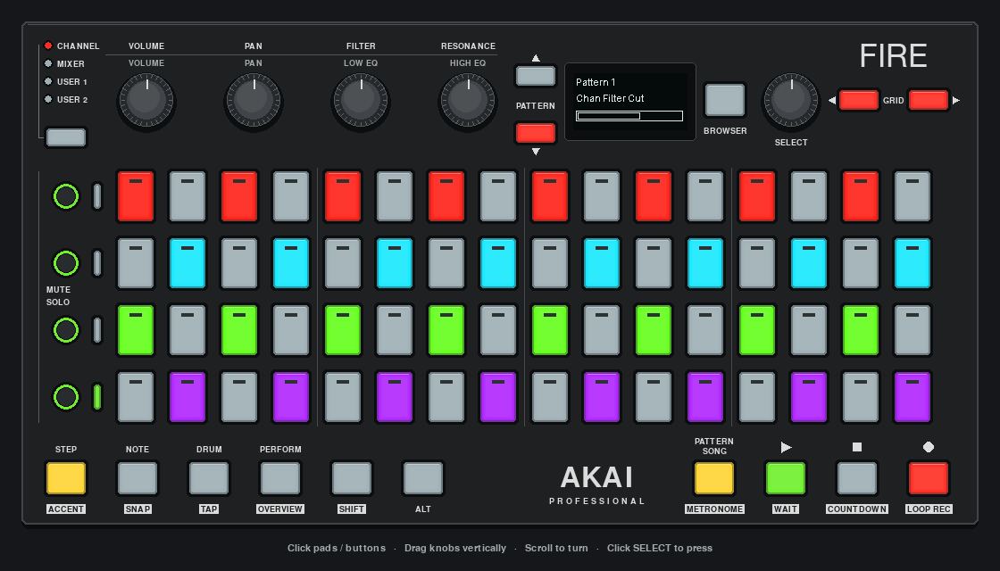
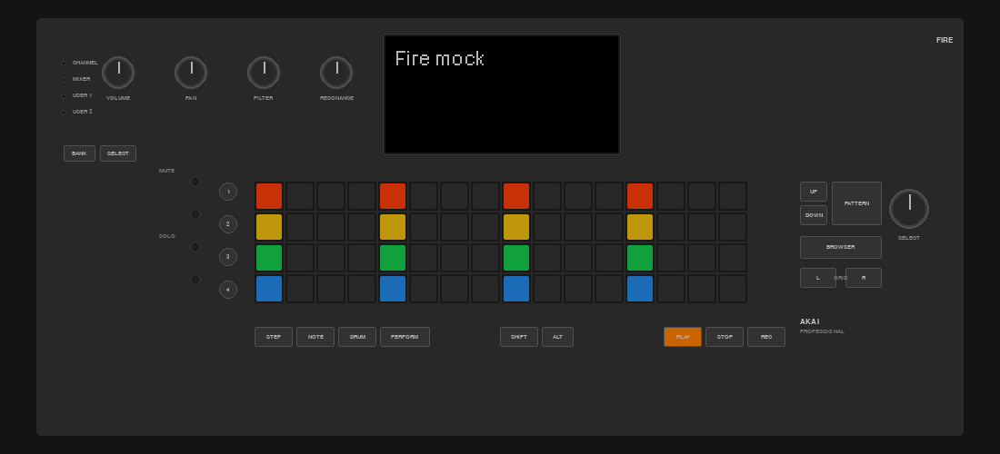
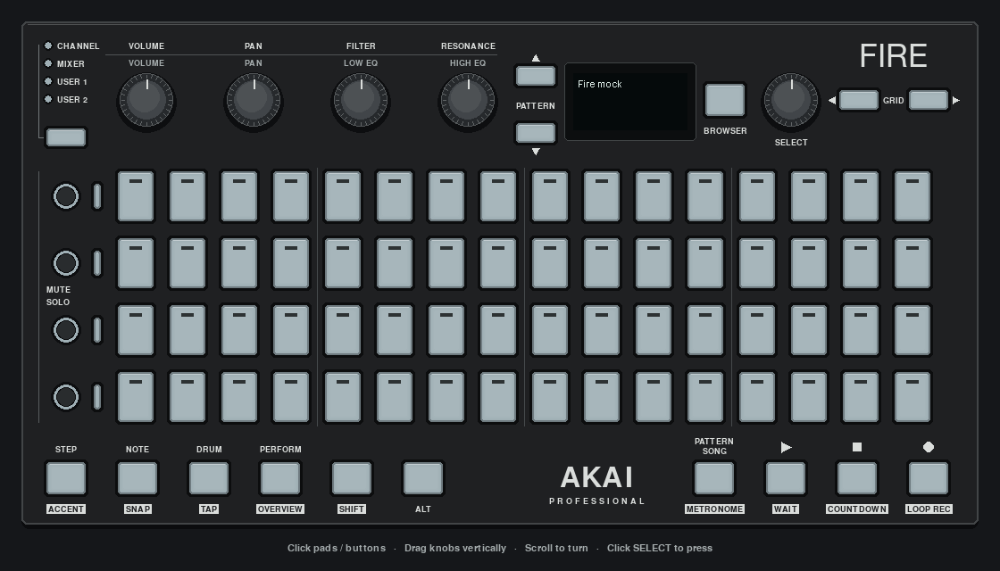

# Pygame controller mock

Run `just mock` or `uv run python mock_gui_pygame.py` from the repository root.
The window shows the app's actual pad, button, track LED and OLED state.

The README's [animated demo](images/mock-demo.gif) and [still PNG](images/mock-demo.png)
capture the real JT-4000 editor in preview mode. Scripted input drives its normal
event handlers: four pad faders, cutoff history, an ADSR envelope and note
auditions. No instrument port is opened and no audio is recorded.

## Hardware reference

The layout follows the [Fire's straight-on product photograph](https://files.soniccdn.com/files/2018/09/27/Fire_ortho_web.jpg)
and the top-panel diagram on page 4 of [Akai's user guide](https://cdn.inmusicbrands.com/akai/fire/Fire-UserGuide-v1.0.pdf).

| Detail | Mock implementation |
| --- | --- |
| Wide, shallow chassis | Approximately 1.9:1 panel proportions, charcoal finish |
| 4 × 16 pads | Tall translucent caps, four groups of four columns, equal spacing |
| Top controls | Bank indicators, four encoders, pattern arrows, OLED, Browser, Select, grid arrows |
| Left edge | Four round mute/solo buttons and narrow rectangular track LEDs aligned with pad rows |
| Bottom controls | Modes and modifiers on the left; Pattern/Song and transport on the right |
| LEDs | Green Play/solo, red Record/navigation, yellow modes; track LEDs support both red and green brightness levels |
| OLED | All 128 × 64 pixels displayed at native resolution, light text on a dark face |

The OLED is slightly larger relative to the panel than in the photograph so its
native pixels stay readable. Labels use available fonts rather than reproducing
the exact printed branding. Pad and LED colors approximate lit hardware; they
are not colorimetric measurements. FL Studio functions printed on the panel are
legends: the running Python app decides what each control does.

## Mouse controls

- Click a pad or button to dispatch its event.
- Drag an encoder vertically; the drag stays attached after leaving the knob.
- Scroll while pointing at an encoder to turn it.
- Click SELECT to press its switch. Dragging SELECT turns it without pressing.
- Releasing outside a button, or leaving the window's focus, clears held input.

Drawing and hit testing share the same rectangles. Automated checks cover all
64 pads and every button, overlap/bounds, LED colors, OLED polarity, encoder
capture, SELECT click-versus-drag and focus-loss cleanup. The live pygame
automation example also exercises posted mouse events in a real window.

## Comparison

Before:

Updated, with all lights off:

These are captures of pygame's rendered surface, not design mockups. The lit
capture above uses an illustrative pattern to compare placement and colors
with the reference photograph.

## Checking pad colors

Run `just example pads_color_cycle` for visible red, green and blue sweeps.
Pad RGB channels use 0–127; this demo samples brightness 32, 64, 96 and 127.
An earlier version incorrectly used only 0–3, making its colors almost gray.
The corrected demo is tested to reach full brightness in every channel and
clear the pads on exit.
