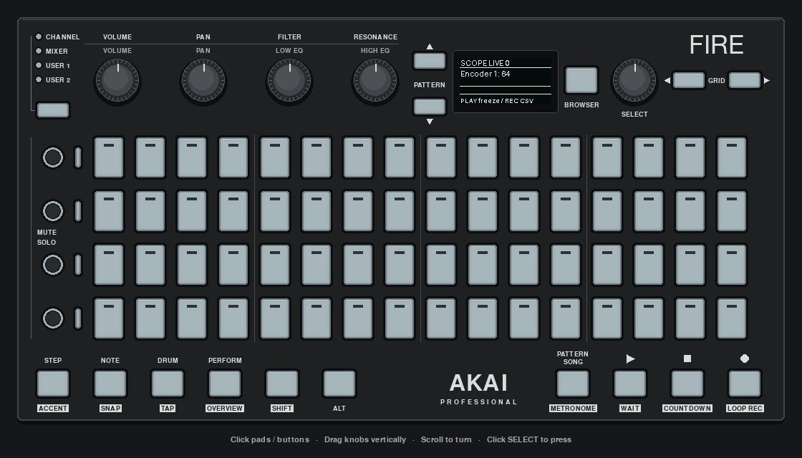
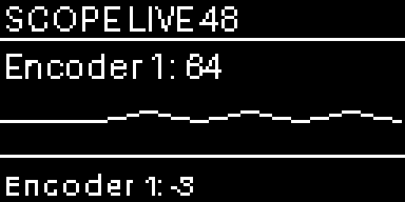

# MIDI Scope

A diagnostic surface for the Fire's interpreted input events. Use it to check pad positions, encoder direction/speed, modifier buttons and callback processing order while developing an app.

[](../../docs/images/midi-scope-gui.png)

*Actual GUI capture with scripted pad and encoder events, followed by frozen graph and log views. [Still PNG](../../docs/images/midi-scope-gui.png).*

```sh
uv run python -m examples.apps.midi_scope
```

Pads flash and retain a blue count indicator. Turning a knob selects its trace; the OLED plots the relative encoder's accumulated value, clamped to 0–127. This is a visualization of turns, not an absolute position reported by the hardware.

| Control | Action |
| --- | --- |
| PLAY | Freeze/resume capture and pad decay |
| BROWSER | Switch between encoder trace and recent event log |
| STOP | Clear history, traces and pad counts |
| REC | Export the retained events to CSV |

STOP retains accumulated encoder values and the selected encoder. Capture continues unless frozen, so a subsequent button release can immediately appear in the cleared log.

The log keeps the most recent 512 events and the graph keeps 64 values. CSV columns are elapsed seconds, kind, control ID, and value. Export defaults to `midi-scope.csv`; set `MIDI_SCOPE_CSV` to change the path. Exports overwrite that file.

This monitors controller events exposed by the driver. It is not a raw MIDI-byte sniffer and does not open an external instrument port. Timestamps are taken when the app callback runs; they include dispatch latency. The default driver uses four callback workers, so recorded order can differ from hardware arrival order. Hardware pad releases are not currently exposed. Tests cover capture, freeze, graph state, clear and CSV output.



Preview generated from simulated input using the app’s drawing code.
