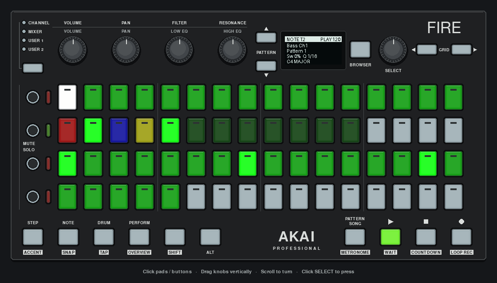
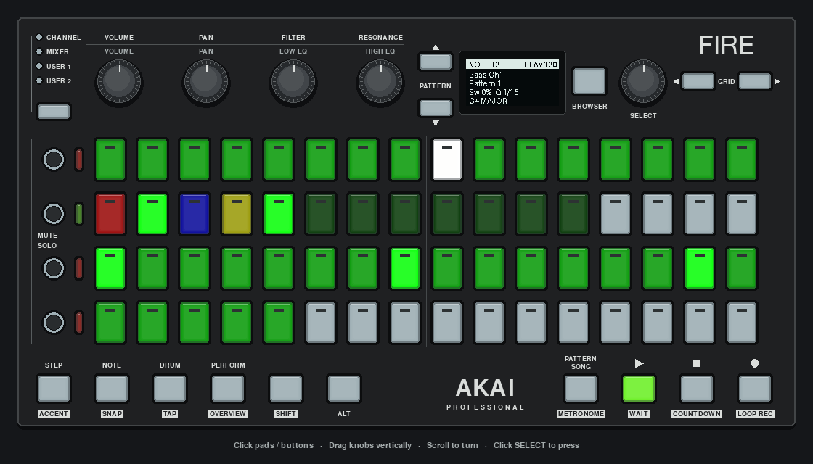
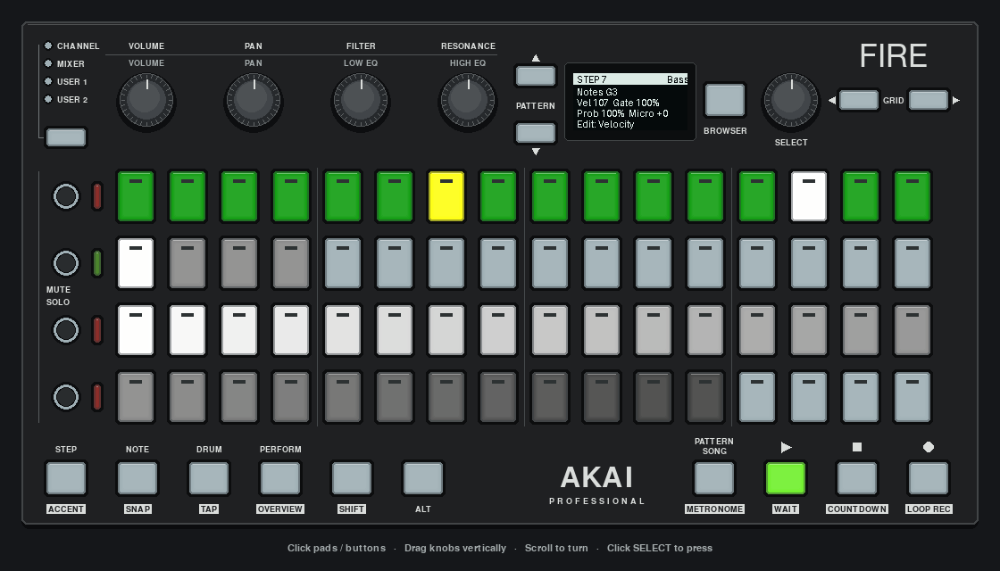
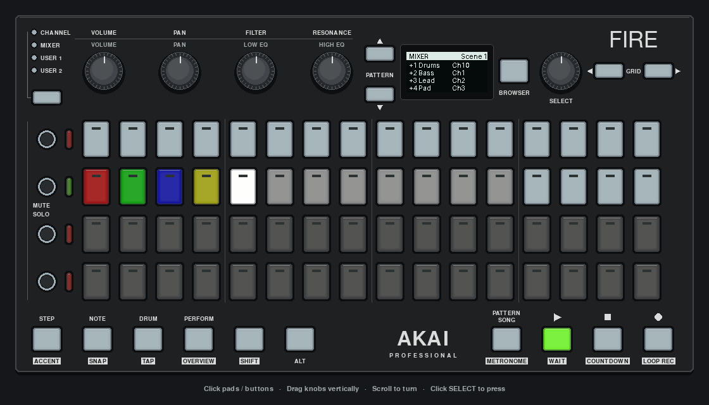

# Circuit sequencer

A four-track MIDI sequencer controlled from the Fire. It has a scale keyboard, step editor, mixer, pattern chains, scenes, and settings. It sends MIDI to external instruments; it does not synthesize audio.

[](../../../docs/images/circuit-note.png)

*Actual app capture: a three-track pattern playing while switching through Note, Step, Mixer and Pattern views. Input is scripted and instrument ports are mocked; the GIF contains no audio.*

```sh
uv run python -m examples.apps.circuit
```

Each launch prints the available MIDI ports. Without `CIRCUIT_MIDI_OUTPUT`, the app runs in preview mode. Select exact port names to send/record MIDI:

```sh
CIRCUIT_MIDI_OUTPUT="Your instrument" CIRCUIT_MIDI_INPUT="Your keyboard" \
  uv run python -m examples.apps.circuit
```

Input is optional. The Fire port is reserved for the controller and rejected as an instrument port. Track channels start at 10 (drums), 1 (bass), 2 (lead), and 3 (pad); change them in Settings.

## First try without an instrument

Preview mode lets you edit and play patterns visually. Silence is expected: the Fire is a controller, and Circuit does not generate computer audio.

1. Press STOP, then SOLO 1 and STEP. SOLO 1 is the small button beside the top pad row; it selects the first track.
2. Tap the top-left pad to select step 1. On the second pad row, tap the third pad from the left to select **pitch**. Tap the leftmost pad on the third row to write a note at that step.
3. On the top row, select pads 5, 9 and 13 in turn. After each selection, tap that same third-row pad to add another note. This makes four evenly spaced notes in a 16-step pattern.
4. Press NOTE, then PLAY. The white playhead moves along the top row; the four programmed steps mark the pattern. Press STOP to stop playback. The pattern stays in memory.

STEP edits individual events; NOTE provides a keyboard for playing and recording; DRUM opens the mixer; PERFORM opens pattern selection; BROWSER toggles Settings. Start with NOTE and STEP before exploring the other views. Rows are counted from the top and columns from the left.

## Make a pattern

1. Press SOLO 1–4 to choose a track and NOTE for the scale keyboard.
2. Press REC and play the bottom two pad rows to record notes into the running pattern. Pad auditions last 300 ms because the driver currently exposes presses without releases.
3. Press STOP, then PLAY to hear the pattern.
4. Press STEP to select a step on row 1. On row 2, pads 1–4 select velocity, timing, pitch, and length. The bottom two rows set the selected value. Pitch creates/replaces a single note; velocity applies to every note in that step.
5. Row 2 pads 9–12 copy, paste, clear, or duplicate the selected step.

The step editor currently addresses the first 16 steps; patterns can store/play up to 32. Timing edits store −6…+6 micro offsets, but playback clamps negative offsets to the boundary because there is no look-ahead engine. Positive offsets delay notes by up to 10% of a step. Gate lengths end independently of the next step tick. Pattern sync rate currently scales gate durations, not the track's step clock.

## Controls

| Control | Action |
| --- | --- |
| PLAY / REC / STOP | Toggle playback / record selected track / stop and silence |
| NOTE / STEP / DRUM / PERFORM | Keyboard / step editor / mixer / patterns |
| SOLO 1–4 | Select track |
| BROWSER | Toggle Settings |
| GRID LEFT/RIGHT | Octave in Note mode; navigation in other modes |
| VOLUME / FILTER / PAN | Mode-specific controls; Note mode uses BPM / swing / quantization |
| SELECT encoder | Navigate/edit Settings; select a scene in Patterns; first encoder action in other modes |
| SELECT button | Enter/finish editing or execute a Settings action; launch selected scene in Patterns |

Mixer solo uses the track's persisted `soloed` state. External keyboard note-ons record into the selected recording track; input is not forwarded as general MIDI-through.

## Edit settings with SELECT

1. Press BROWSER, then turn SELECT to highlight a setting.
2. Press SELECT. The OLED shows `Edit: <setting>` and its current value.
3. Turn SELECT to change the value. Changes apply immediately.
4. Press SELECT again to return to navigation.

Navigation stops at the ends of the list. VOLUME and GRID LEFT/RIGHT always navigate, ending an active edit. FILTER/PAN changes the selected value directly. Leaving Settings also ends editing. Save/Load Settings are actions: press SELECT once to execute them. They store configuration at `~/.circuit_sequencer_settings.json`, not a full song.

## Select and chain patterns

Press PERFORM. Each pad row belongs to the matching track, top to bottom. Columns 1–8 select that track's patterns 1–8; columns 9–16 are unused. There is no separate track-selection step.

- Tap a pattern to select it and clear that track's previous chain.
- To chain a consecutive range, hold SHIFT, tap the first pattern, then tap the last pattern in the same row. For example, row 2 pads 2 and 5 create the track 2 chain `2>3>4>5`.
- While choosing the end, the start pad is white and the OLED says `P2>tap end`. There is no timeout. Releasing SHIFT or leaving Patterns cancels unfinished selections, preserving the existing chain.
- The endpoints can be tapped in either order. Separate rows keep separate selections; a tap on another row cannot extend the first row's chain.

Turn SELECT or use GRID LEFT/RIGHT to select a scene, then press SELECT to launch it. A `?` after the scene number means it is selected but not active. While playing, launches wait for the next pattern boundary: `S4 Q3` means scene 4 is selected and scene 3 is queued. Browsing does not change the queued launch; pressing SELECT queues the newly selected scene instead. Scenes hold pattern selections for all four tracks; the current UI has no scene-save control, so populated scene snapshots must be supplied in code.

## Screen views

Playback and edit views use a separate header and four content rows; Settings shows three full menu items at a time. NOTE shows track/channel, pattern, swing/quantization and scale or active notes. STEP shows notes, velocity/gate, probability/microtiming and the selected edit parameter. MIXER reserves one row per track; `+` means enabled, `-` muted and `S` soloed.

| Note keyboard and playback | Step editing |
| --- | --- |
|  |  |



Long labels and pattern chains are shortened with an ellipsis. Settings scrolls to keep the selected item visible.

## Automated demo and tests

```sh
uv run python -m examples.apps.circuit.demo_e2e --demo modes
uv run python -m examples.apps.circuit.test_pygame_smoke
uv run python -m unittest discover
```

The app uses `AkaiFireApp` and `on` decorators for foreground controller input, display refresh and controller ownership. Pattern gestures use captured SHIFT state; a release handler cancels unfinished chains. Controller input is processed on UI frames, so Fire pad auditions/recording may incur a frame of latency (more under backlog). External MIDI input, the musical clock and note scheduler remain independent in `core/`, with their synchronization retained; UI modes live in `ui/modes/`. Pad frames are composed in memory and sent as one batch, avoiding bursts of individual clear-and-repaint messages.

A [Fire hardware check on 9 November 2026](../../../docs/HARDWARE_VERIFICATION.md) exercised all five modes and PLAY/STOP for over two minutes after batching was added. Follow-up checks covered NOTE track selection, header spacing, Mixer labels/mute feedback, Settings scrolling and SELECT editing, and the revised pattern-chain gesture. Detailed STEP editing, musical timing and synth integration still need focused hardware checks. [spec.md](spec.md) is historical design material, not a promise that every proposed feature is implemented.
