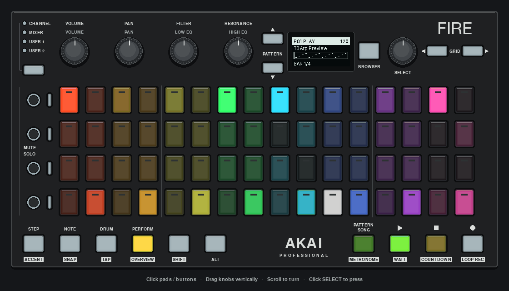

# Eight Track



[Still image](../../../docs/images/eight-track.png). These captures show the real
mock application, not a hardware photograph.

An MMT-8-inspired sequencer prototype, progressing toward an eight-track recorder
through hardware-verified stages.
The current stage is a **playable control prototype**: three seeded four-bar
parts, eight independent tracks, computer preview sound, track selection/muting,
queued part changes and reversible playback controls. MIDI recording, instrument
ports, saving, song arrangement and Fire keyboard input are not implemented yet.

```bash
uv run python -m examples.apps.eight_track
uv run python -m examples.apps.eight_track --hardware
uv run python -m examples.apps.eight_track --silent --duration 10
```

The default opens the pygame mock. `--hardware` explicitly opens the Fire. Audio
plays on the computer, with no external instrument port opened. Press PLAY to
hear the demo; it starts stopped. Ctrl+C exits and silences the preview.

## Start here

1. Press PLAY. The upper three pad rows show eight strips of musical activity.
2. In the bottom row, pads form eight pairs. The left pad selects a track; the
   right pad mutes/unmutes it. The selected pad is white, and an enabled track's
   mute pad is bright in its track color. Selecting does not change audibility.
3. Press SELECT to open that track's settings. Press again to edit Transpose,
   turn to change it, then press to finish. PERFORM returns to the overview.
4. Press PATTERN (beside PLAY). The first three top-row pads select parts.
   During playback, the next part is marked NEXT and starts at the current
   four-bar part's end. Selecting the current part cancels a queued change.
5. Press STOP to stop; PLAY resumes. Press STOP again while stopped to rewind.

## Controls

| Control | Action |
| --- | --- |
| Bottom pads, columns 1/3/5/…/15 | Select tracks 1–8 |
| Bottom pads, columns 2/4/6/…/16 | Mute/unmute tracks 1–8 |
| SELECT turn | Select a track, browse parts, or navigate/edit settings |
| SELECT press | Open track settings; edit/confirm a value; launch a highlighted part |
| GRID LEFT/RIGHT | Navigate tracks, parts or settings; retain editing on editable destinations |
| VOLUME | Tempo, 40–240 BPM |
| PAN | Playback quantize: Off, 1/8, 1/16 |
| FILTER | Swing, 0–100% of the available swing offset |
| RESONANCE | Selected-track transpose, -24 to +24 semitones |
| PLAY | Start/resume |
| STOP | Stop and silence; a second press rewinds |
| PATTERN | Part browser |
| PERFORM | Track overview |
| BROWSER | Short control reminder |
| REC | Shows that recording belongs to the next build stage |

The four main knobs operate in the overview only. Top-three-row pads are visual
indicators there. In the part browser only the first three top-row pads launch
parts. Neither pad function depends on a gesture timeout.

## How it works

`app.py` uses `AkaiFireApp`, input decorators, `GridMixin`, `ScreenMixin` and
`EncoderMenu`. Input handlers send commands to `Engine`; the app renders one
immutable snapshot to both the pad grid and OLED. The engine owns playback,
mute state, transformations, active notes and pending part changes. It runs on a
separate monotonic clock thread. Tests drive the same engine through `advance`
without starting a thread, and deliver app input through `tick`.

`model.py` provides immutable demo phrases. Quantize, swing and transpose leave
those phrases intact. The small preview synth generates its own samples and
keeps voices separate by track. Muting one track cannot silence another track's
voice. It is a demo sound source, not a general MIDI synthesizer.

Playback uses a 5 ms polling interval, not a hard real-time guarantee. A stall
over 100 ms skips expired attacks and resumes notes at the current musical
position, rather than playing a burst of stale notes. An output failure stops
the clock and requires an app restart. No external MIDI timing or recording
accuracy has been established by this stage.

The full direction and staged acceptance checks are in
[the concept](../../../docs/MMT8_CONCEPT.md). The first hardware pass checks the
control mapping and readable feedback before recording or project menus grow.
