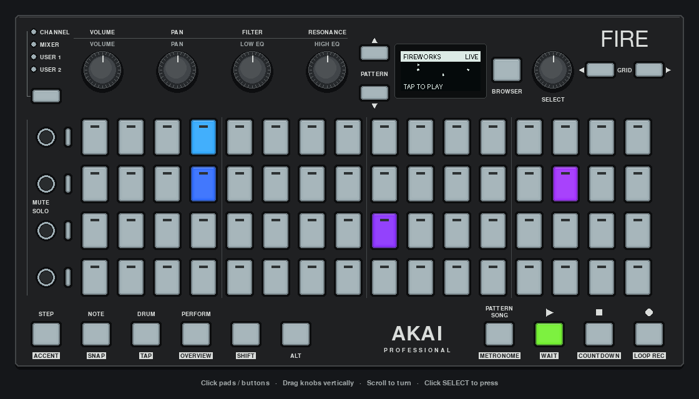

# Firestorm

An interactive particle instrument built with the application framework. Tap the pads to launch fireworks, expanding ripples or orbital particles. The OLED shows the detailed 128×32 light field; each pad displays the combined color and energy in its matching 8×8 region.



*Actual app capture with scripted input across all three scenes. [Fireworks](../../../docs/images/firestorm-0.png), [ripples](../../../docs/images/firestorm-1.png), [orbit](../../../docs/images/firestorm-2.png).*

```sh
uv sync --all-extras
uv run python -m examples.apps.firestorm
uv run python -m examples.apps.firestorm --hardware
uv run python -m examples.apps.firestorm --silent
```

The default is pygame, even with a Fire attached. `--hardware` explicitly selects the Fire and uses one callback worker for ordered input. Sound comes from the computer, not the Fire or an external MIDI instrument. Short synthesized notes need no sample downloads; missing audio support falls back to silent visuals. The automatic display is silent; only manual pad taps play notes.

Start by tapping a few pads. The opening automatic animation stops taking over as soon as you play. Scroll SELECT to try the other scenes; each starts a new automatic display. In pygame, click pads and buttons, drag knobs vertically or scroll over them.

| Control | Action |
| --- | --- |
| Pad | Launch a burst and a short note; columns follow a pentatonic scale, rows change timbre |
| SHIFT + pad | Toggle an attractor; up to four, shown as white pads and OLED boxes |
| VOLUME | Energy: burst density and speed |
| PAN | Gravity: downward force, orbital attraction or ripple speed |
| FILTER | Trail persistence |
| RESONANCE | Hue of future bursts |
| SELECT turn or press | Previous/next scene, or next scene on press |
| PLAY | Freeze/resume the simulation; pausing stops current audio |
| STOP | Clear particles, trails and attractors; disable auto; resume from pause |
| REC | Toggle silent automatic bursts |
| BROWSER | Toggle the control reminder |
| Window close / Ctrl+C | Quit and clean up |

Attractors bend particles in Fireworks and Orbit; Ripples remain expanding circles. Tapping while paused can add a burst, but it does not move until resumed. SHIFT gestures require hardware or simulated input because the mouse mock cannot hold a button and click a pad simultaneously. There is no pad-release API: sounds decay within 0.35 seconds rather than being held.

## How it uses the framework

`FirestormApp` combines `AkaiFireApp`, `ScreenMixin` and `GridMixin`. All input uses app decorators. For example:

```python
@on.pad()
def launch(self, event):
    row, column = self.pad_position(event.pad)
    if event.shift:
        self.world.attract(row, column)
    else:
        self.world.burst(row, column)
```

This is an excerpt of the visual interaction; the full handler also plays a note. The framework captures modifier state, queues the event, invokes the bound method on the frame thread and removes its subscription on shutdown. The app owns its simulation and stops its injected sound on shutdown; the launcher owns and closes the sound object. No custom input queue, worker or model lock is needed. `on_update(dt)` advances the world and draws both views. One pad batch is sent per frame.

- [app.py](app.py): decorated controls, screen and pad views.
- [model.py](model.py): seeded simulation, bounded particles/rings, trails and color-preserving brightness mapping.
- [audio.py](audio.py): short cached waveforms and owned-audio cleanup.
- [__main__.py](__main__.py): backend/audio options and ownership.
- [Framework reference](../../../docs/FRAMEWORK.md): event contracts, ordering and overflow behavior.

The simulation caps a frame's physics step at 50 ms after stalls. It is a visual playground, not a precise physics engine or musical sequencer. Particle/ring counts and audio cache size are bounded. Audio and visual settings are not persisted.

```sh
uv run python -m unittest tests.test_app_events tests.test_firestorm
uv run python -m examples.apps.firestorm --silent --seed 17 --duration 2
```

Automated checks cover all scenes, boundaries, pause/clear, decorator routing, modifier snapshots, shared rendering, OLED text and short audio buffers. Captures and CLI smoke tests use pygame; hardware and audible playback observations are recorded separately in [hardware verification](../../../docs/HARDWARE_VERIFICATION.md).
