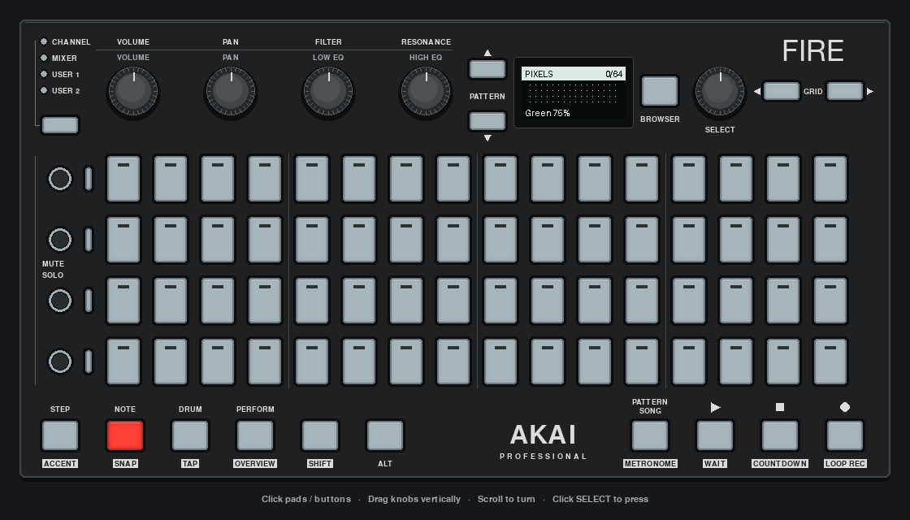

# Pixel editor

A complete app for the [building-an-application tutorial](../../../docs/BUILDING_AN_APP.md). Paint a 16×4 color picture on the pads, preview occupied pixels on the OLED, and save/load JSON. It uses `AkaiFireApp`, `ScreenMixin` and `EncoderMenu`.

[](../../../docs/images/pixel-editor.png)

*Scripted input drives the app's normal callbacks in the pygame mock. The OLED is monochrome; the pads display each pixel's color.*

From the repository root:

```sh
uv run python -m examples.apps.pixel_editor
uv run python -m examples.apps.pixel_editor --hardware
uv run python -m examples.apps.pixel_editor --file ./my-picture.json
```

The default is pygame, even with a connected Fire. `--hardware` requires the Fire and uses one callback worker to preserve event order. No instrument MIDI port is opened. In pygame, click controls and scroll over SELECT; same-color taps erase pixels without needing a modifier gesture.

| Control | Draw view | Settings view |
| --- | --- | --- |
| Pads | Paint current color; same-color tap erases | Ignored |
| SHIFT + pad | Erase any color | Ignored |
| VOLUME / PAN / FILTER | Adjust brush red / green / blue, 0–127 | Same direct adjustments; stay on the selected menu item |
| RESONANCE | Adjust global brightness, 10–100% | Same direct adjustment |
| SELECT turn | Choose brush color | Navigate, or change an edited value |
| SELECT press | Open Settings | Enter/finish editing, or execute action |
| GRID LEFT/RIGHT | Previous/next brush color | Previous/next item; keep editing if the destination is editable |
| BROWSER | Open Settings | Return to Draw |
| NOTE | Stay in Draw | Return to Draw and finish editing |
| REC | Save | Save |
| SHIFT + STOP | Clear picture, preserving brush/brightness | Clear picture, preserving brush/brightness |

Settings contains Color, Brightness, Save, Load, Back and Quit. RGB knob changes create a custom brush without recoloring existing pixels. The OLED shows its channel levels and brightness. SELECT or GRID in Draw returns to presets; a black brush erases. Brightness changes apply to all pixels immediately; choosing a brush changes only future painting. An asterisk beside the OLED count means there are unsaved changes. Quit through Settings, close the mock window or press Ctrl+C.

Save replaces `pixel-art.json` in the current directory unless `--file` specifies another path. Its parent directory must exist. There is no automatic loading or saving. Load replaces the current picture, including unsaved changes; save first if you want to preserve them. Version 2 stores exact RGB colors, including the custom brush. Original version-1 palette files still load and are converted when saved. Invalid files leave the current picture intact. Save/load errors appear briefly on the OLED and print details in the terminal.

## Source and checks

- [first_light.py](first_light.py): runnable first checkpoint, pad toggles and an OLED count.
- [model.py](model.py): palette, picture operations, validated loading and temporary-file replacement on save.
- [app.py](app.py): queued input, two views, menu and output rendering.
- [__main__.py](__main__.py): explicit backend selection and controller ownership.
- [tests](../../../tests/test_pixel_editor.py): interaction, persistence, layout and lifecycle checks.

```sh
uv run python -m examples.apps.pixel_editor.first_light
uv run python -m unittest tests.test_pixel_editor tests.test_tutorial_docs
uv run python -m examples.apps.pixel_editor --duration 2
```

The first checkpoint is pygame-only and takes no command-line options. The full editor's `--duration` option exercises the normal loop and shutdown. A hardware walkthrough confirmed the original painting/OLED, menu and save controls. A later RGB check confirmed all four main knobs, readable levels and exact save/load restoration. SHIFT+STOP clearing was not captured; it remains covered by automated tests. Automated checks also use mocks. Pad releases, drag painting, undo, autosave and reconnect recovery are not implemented.
