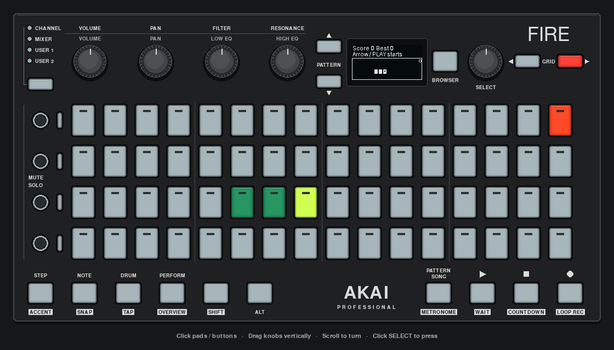

# Snake

A playable Snake game with two views of one 16×4 board. The pads show the snake and food in color; the OLED shows the same cells, score and game status.

[](../../../docs/images/snake.png)

*Captured from the running app with scripted presses of the mock's buttons. [Still PNG](../../../docs/images/snake.png).*

```sh
uv run python -m examples.apps.snake
# Or: just app snake
```

The app uses a connected Fire or opens the pygame mock. It needs no external instrument or audio setup.

| Control | Action |
| --- | --- |
| PATTERN UP / DOWN | Steer up / down |
| GRID LEFT / RIGHT | Steer left / right |
| PLAY | Start, pause/resume, or retry after a crash or win |
| STOP | Reset the board and wait for a new start |
| Ctrl+C / close mock window | Exit |

A valid direction press also starts a new board. Reversing into the snake's neck is ignored. Only one turn is accepted per movement tick, so rapid presses cannot reverse the snake before it moves.

Eat the orange-red food to grow and gain a point. The head is lime green, the body dark green, and a crashed head turns red. Walls and the body end the game; entering the cell the tail is leaving is allowed. Filling all 64 cells wins. Movement speeds up from 320 ms to a minimum of 120 ms per cell. Best score lasts for the current app session, including restarts.

## How the views stay in sync

- `game.py` owns the snake, food, direction, score and ready/running/paused/over/won state. It has no controller or drawing dependencies.
- `app.py` maps buttons to game commands and advances the model from `on_update(dt)`. A lock coordinates hardware callbacks with the frame thread.
- Both renderers read that model. Cell `(x, y)` maps to pad `y * 16 + x` and the corresponding 8×10-pixel OLED cell. The OLED uses a hollow marker for the head and a small circle for food.

A delayed frame advances at most one cell so the player can react after a pause in rendering. The game does not run a second movement thread.

```sh
uv run python -m unittest tests.test_snake tests.test_oled_layouts
```

Tests cover steering through the real event subscriptions, growth, collisions, pause/restart, winning, cleanup and agreement between pad colors and real canvas pixels. A [Fire hardware check on 9 November 2026](../../../docs/HARDWARE_VERIFICATION.md) confirmed responsive steering, pause/resume, reset and matching pad/OLED views.
