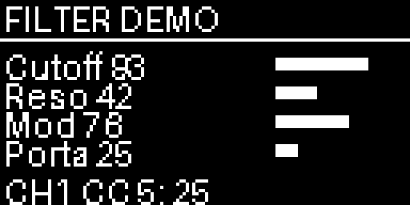
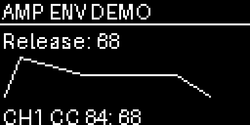

# JT-4000 editor

Use the Fire's four knobs and pad rows as a parameter surface for a Behringer JT-4000 MICRO. The OLED shows four values, a focused parameter trace, or a normalized envelope drawing. The grid becomes either four faders or a short-note audition keyboard.

```sh
uv run python -m examples.apps.synth_editor
```

The app connects automatically only if exactly one MIDI output contains `JT-4000`. Otherwise it stays in `DEMO` mode so you can explore with the pygame mock. Explicit routing:

```sh
SYNTH_MIDI_OUTPUT="JT-4000 MICRO" SYNTH_MIDI_CHANNEL=1 \
  uv run python -m examples.apps.synth_editor
```

The Fire and synth need separate MIDI connections to the computer. Listen through the synth's audio output. This app sends MIDI; it does not generate audio.

## OLED preview




These previews use the actual drawing code with a fake instrument output.

## Controls

| Control | Action |
| --- | --- |
| VOLUME / PAN / FILTER / RESONANCE | Edit parameter 1 / 2 / 3 / 4 on the page |
| SHIFT + knob | Fine adjustment: one unit per turn event |
| Pad rows | Four 16-position parameter faders |
| GRID LEFT/RIGHT or SELECT encoder | Previous/next parameter page |
| SHIFT + GRID LEFT/RIGHT | Change MIDI channel, silencing auditions first |
| NOTE | Toggle the 64-note audition grid (MIDI 36–99) |
| PLAY | Audition a C-major chord for 300 ms |
| STOP | Send note-offs for tracked auditions |
| BROWSER | Toggle overview and detail/shape view |
| REC | Save locally known CC values |
| SELECT button | Validate and send a saved snapshot |

Pages are Filter (cutoff/resonance/modulation/portamento), Amp Envelope, Filter Envelope, and LFO (two amounts and rates). Values are raw 0–127, not Hz or milliseconds. The CC map follows [Behringer's JT-4000 MICRO Quick Start Guide, pages 52–53](https://mediadl.musictribe.com/media/PLM/data/docs/0722-ABR/QSG_BE_0722-ABR_JT-4000-MICRO_WW.pdf). JT-4000M-specific extensions are not included.

## What the screen means

`?` means no value has been sent for that control. The editor does not read the synth's current patch. A knob's first adjustment starts from 64; a pad fader sets an absolute value. Startup sends no parameter changes. The envelope plot is an illustrative normalized shape, not a measurement of the synth's timing curve. Other pages show the history of edits to the selected parameter.

Snapshots default to `jt4000-snapshot.json` in the working directory; override with `SYNTH_SNAPSHOT=/path/to/file.json`. Save uses a temporary file and replacement. Load validates the whole file before sending any CCs. A snapshot contains only values known to this editor, not a native preset/SysEx dump, and does not change the output port or MIDI channel.

Auditions are capped at four simultaneous notes. They end on frame updates after 300 ms, and STOP/channel-change/shutdown send note-offs. This is a patch-editing aid, not a performance keyboard or sample-accurate scheduler. Unplugging a synth can prevent delivery of note-offs; use the synth's own controls after reconnecting if necessary.

## Implementation

- `parameters.py`: immutable page/CC definitions sourced from the manual.
- `midi.py`: port selection, channel routing, note deadlines, cleanup.
- `app.py`: UI, event handling, local state and snapshots.

An injected `output=` is an exclusive controller session: the app leaves its port open but silences all tracked auditions on shutdown. Do not share it with another live player. The default app-created output is closed on shutdown.

Tests verify MIDI bytes, channel changes, audition expiry, failure cleanup and snapshot validation without opening physical ports. The editor replaces the earlier non-running modular Groovebox scaffold. Hardware verification is still outstanding.
